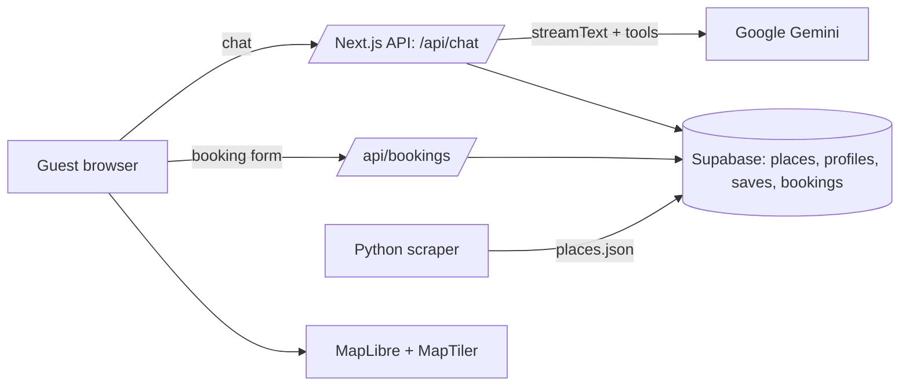

# Pearl Club AI Concierge

An AI travel concierge for hotels, grounded in real [Pearl Club](https://www.pearlclub.com) recommendations from locals.

- **Live demo:** _add Vercel URL_ · **2-min walkthrough:** _add Loom URL_
- **Test tips:** tap the four menu chips from the welcome screen; try `/?hotel=casa-mar` for Barcelona; switch to العربية for RTL; allow location for distance-sorted picks.

## What it does

- **Find Hidden Gems** – real places as cards (photo, price, distance, Save, Book, link to Pearl Club) plus an inline map.
- **Plan My Day** – a morning → evening timeline built from real places, with a numbered route map.
- **Book an Experience / Hotel Services** – the bot prepares a booking form; the guest reviews and submits. Requests are stored and confirmed in-app.
- **Personalisation** – onboarding chips, preferences learned from chat, saved places, and browser location.
- **Six languages** – EN, ES, FR, DE, AR, UR (AR/UR render right-to-left).
- **Follow-up chips** after every answer; **My Trip** drawer for saves and bookings.

## Architecture



## Key decisions

- **Tool calling over vector RAG.** The model can only recommend places returned by `search_places`, so nothing is invented and every card links back to pearlclub.com.
- **Human-confirmed bookings.** The model proposes a form; the guest submits it. The model never creates a booking.
- **Multi-tenant hotel config.** Hotels live in config (`?hotel=`), so a new hotel is data, not code.
- **Scraping scope.** Pearl Club's city pages load listings from its own GraphQL API; the scraper replays that request politely (≤1 req/s, cached) for 5 cities, about 1,800 places.

## Brief → feature mapping

| Brief requirement | Implemented as |
|---|---|
| Conversational interface | Streaming chat via Vercel AI SDK + Google Gemini |
| Pearl Club content | Python scraper → JSON → Supabase `places` → `search_places` tool |
| Personalisation | `profiles` + `saved_places` in the system prompt; geolocation distance sorting |
| Hotel concierge bookings | `propose_booking` → inline form → `/api/bookings` → Supabase |
| Multilingual | Language selector, UI dictionary, model replies in chosen language, RTL |
| Context-aware plans | `plan_day` tool → timeline + route map |
| Location-based suggestions | Browser geolocation → distance sort and labels |
| Greeting & menu flow | Welcome screen with four menu chips |
| Follow-up interaction | `suggest_followups` tool → chips |
| Hotel services | Per-hotel service list (`get_hotel_services`) |

## Running locally

```bash
npm install
cp .env.example .env.local        # fill in Gemini, Supabase, MapTiler keys
# apply supabase/schema.sql in the Supabase SQL editor, then:
npx tsx supabase/seed.ts          # loads scraper/output/places.json
npm run dev
```

Re-scrape (optional): `cd scraper && python -m venv .venv && . .venv/bin/activate && pip install -r requirements.txt && playwright install chromium && python scrape.py && python normalize.py`

## Limitations

- Bookings are requests, not live inventory; no email is sent (confirmation is in-app).
- Place data is a scraped snapshot; neighbourhoods are not available from the source.
- Demo hotels are fictional. Sessions are anonymous (per browser), with a per-session message cap.

## Next two weeks

- Read Pearl Club's DatoCMS content API directly (live content, no scraping).
- Embeddable chat widget for hotel websites.
- Real booking partners (OpenTable/Resy, GetYourGuide/Viator).
- Semantic "vibe" search with pgvector.
- Guest auth and cross-device trips (Supabase Auth); analytics dashboard for hotels; WhatsApp/SMS channel.

_Not used on purpose:_ Builder.io, DatoCMS, GraphQL, Lemon Squeezy, Perplexity, Replicate, Llama.
