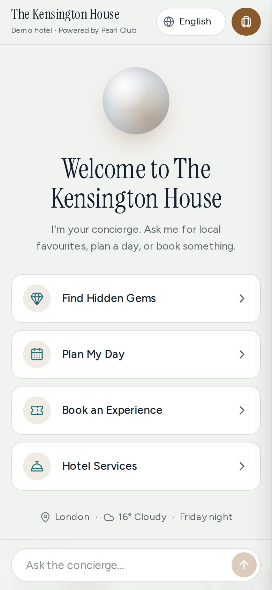
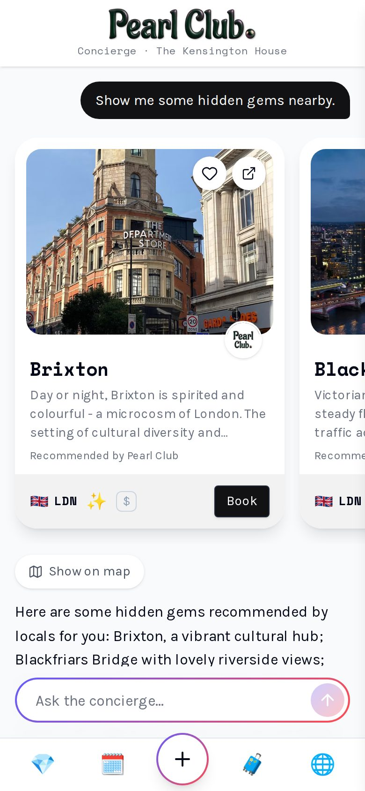
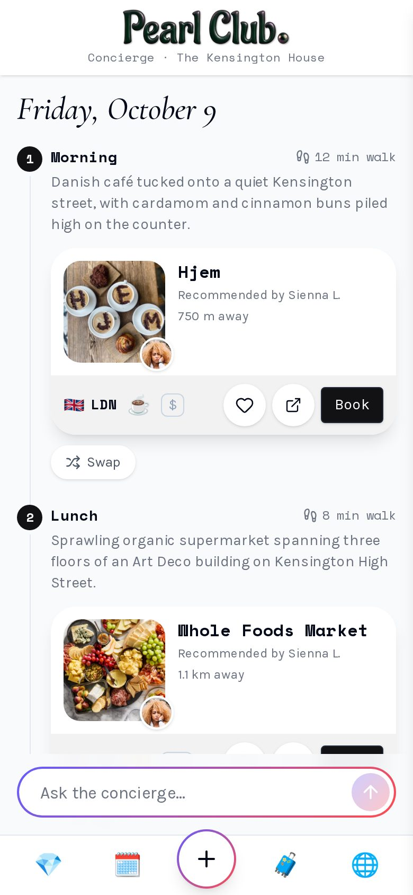
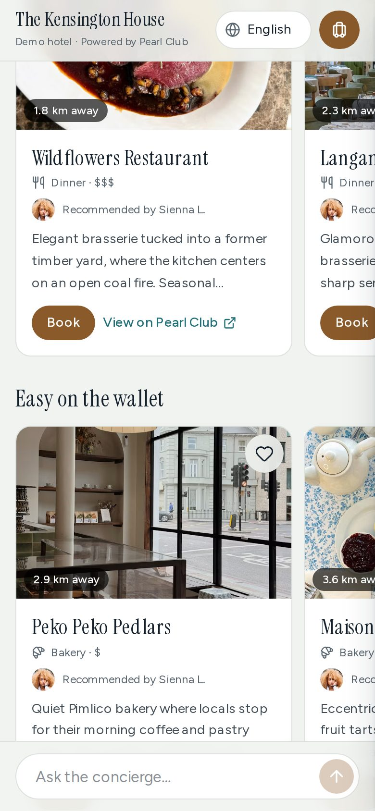
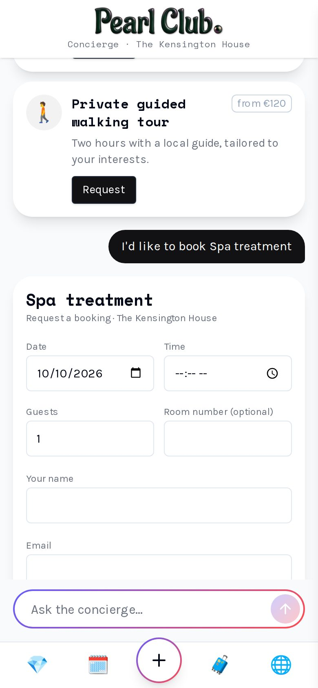
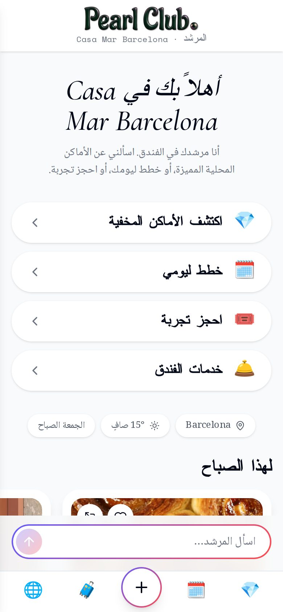
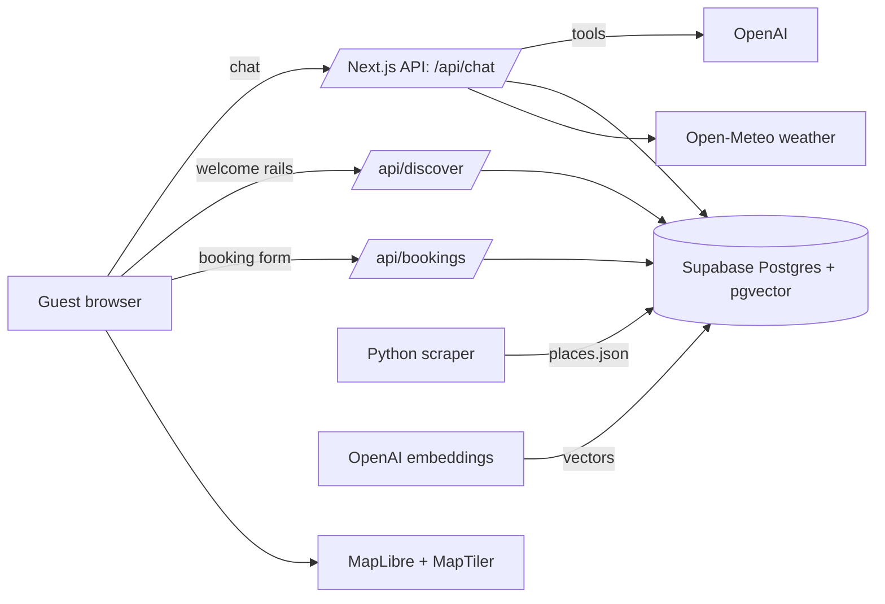

# Pearl Club AI Concierge

An AI travel concierge for hotels, grounded in real [Pearl Club](https://www.pearlclub.com) recommendations from locals. Guests chat, tap, plan a day and request bookings. Every place comes from Pearl Club's own data and links back to pearlclub.com.

**Live demo: https://pearlclub-concierge.vercel.app/**

<table>
  <tr>
    <td></td>
    <td></td>
    <td></td>
  </tr>
  <tr>
    <td></td>
    <td></td>
    <td></td>
  </tr>
</table>

## Try it

- Tap the four menu chips: **Find Hidden Gems**, **Plan My Day**, **Book an Experience**, **Hotel Services**.
- Ask in your own words: _"something cozy for a rainy afternoon"_, _"a romantic dinner with natural wine"_, _"swap the lunch stop"_, _"vegetarian and on a budget"_.
- Tap **Use my location** for distance-sorted picks and a neighbourhood-aware welcome.
- Switch language (EN, ES, FR, DE, AR, UR; Arabic and Urdu render right to left).
- Open `https://pearlclub-concierge.vercel.app/?hotel=casa-mar` for the second demo hotel (Barcelona, different branding and city).
- Ask about a city Pearl Club doesn't cover, or something off-topic, and see the guardrails.

## What it does

- **Instant welcome screen.** Live weather, local time and rails of real places ("Good for this evening", "Loved by locals nearby", "Easy on the wallet") appear with no model call.
- **Find Hidden Gems.** Semantic ("vibe") search over about 1,800 curated places, shown as cards with the photo, price, distance and the **local who recommended it**.
- **Plan My Day.** A walkable morning-to-evening route with walking times between stops, a numbered map, rain-aware indoor picks, and per-stop **Swap**.
- **Book an Experience / Hotel Services.** The assistant prepares a booking request; the guest reviews and submits it. Requests are stored and listed in **My Trip** next to saved places.
- **Personalisation.** Onboarding chips, preferences the assistant learns from chat, saved places and browser location. Preferences are also kept in the browser, so they load instantly.
- **Follow-up chips** after every answer, and visible progress ("Searching local favourites…") while it works.

## Architecture



## Key decisions

- **Tool calling, not free generation.** The model can only recommend places returned by `search_places` or `plan_day`, so nothing is invented. Every card links to its Pearl Club page.
- **Hybrid retrieval.** Embeddings (pgvector, `text-embedding-3-small`) handle "vibe" queries; filters handle category, price and distance; keyword search is the fallback.
- **The server plans the day.** `plan_day` picks stops and a walking route itself in one step, which is faster and more reliable than having the model search and assemble. The model only chooses the theme and mood.
- **Human-confirmed bookings.** The model proposes a form, the guest submits it, and the form posts to the API directly. The model never creates a booking.
- **Native Pearl Club look.** The UI follows pearlclub.com's design system (Karla, Space Mono and Cormorant type, black buttons, pill chips, 24px cards with the flag, category emoji and price strip, the gradient-ring search field and the mobile tab bar), so it reads as part of the same product.
- **Locals first.** Each place carries the Pearl Club local who recommended it. That is the brand's edge over generic travel AI, so it is shown on every card.
- **Multi-tenant by config.** Hotels are data (`?hotel=`), so a new hotel is configuration, not code.
- **Cost and abuse guards.** Caps per session, per IP per day and for the whole demo per day; output-token ceilings on every model call; input and body-size limits.
- **Scraping scope.** Pearl Club's city pages load listings from their own GraphQL API. The scraper replays that request politely (about 1 request per second, cached): 5 cities, 1,779 places.

## Brief → feature mapping

| Brief requirement             | Implemented as                                                                                   |
| ----------------------------- | ------------------------------------------------------------------------------------------------ |
| Conversational interface      | Streaming chat via Vercel AI SDK + OpenAI, with rich cards                                       |
| Pearl Club content            | Scraper → JSON → Supabase `places` → `search_places` / `plan_day`                                |
| Personalisation               | Profile, saved places, browser location and weather in the prompt; distance and interest ranking |
| Hotel concierge bookings      | `propose_booking` → prefilled form → `/api/bookings` → Supabase → My Trip                        |
| Multilingual                  | Six languages, replies in the chosen language, RTL layout                                        |
| Context-aware recommendations | Time of day, weather and location shape the welcome rails, search and plans                      |
| Location-based suggestions    | Geolocation, distance on cards and a neighbourhood label                                         |
| Greeting and menu flow        | Welcome screen with four menu chips                                                              |
| Follow-up interaction         | A dedicated follow-up pass produces tappable chips every turn                                    |
| Hotel services                | Per-hotel service list rendered as request cards                                                 |

## Running locally

```bash
npm install
cp .env.example .env.local            # fill in the keys below
# In the Supabase SQL editor run, in order:
#   supabase/schema.sql
#   supabase/migration_002.sql        (curator columns + vector search)
npx tsx supabase/seed.ts              # loads scraper/output/places.json
npx tsx supabase/embed.ts             # creates the embeddings (about 1 cent, resumable)
npm run dev
```

Re-scrape (optional): `cd scraper && python -m venv .venv && . .venv/bin/activate && pip install -r requirements.txt && playwright install chromium && python scrape.py && python normalize.py`

| Variable                                                                          | Purpose                                                                                                             |
| --------------------------------------------------------------------------------- | ------------------------------------------------------------------------------------------------------------------- |
| `OPENAI_API_KEY`, `OPENAI_MODEL`                                                  | Chat model (a fast tool-calling model; `gpt-4.1-mini` works well). Optional `OPENAI_FAST_MODEL` for follow-up chips |
| `NEXT_PUBLIC_SUPABASE_URL`, `SUPABASE_SERVICE_ROLE_KEY`                           | Database (server only; the service key is never sent to the browser)                                                |
| `NEXT_PUBLIC_MAPTILER_KEY`                                                        | Map tiles                                                                                                           |
| `MAX_MESSAGES_PER_SESSION`, `MAX_MESSAGES_PER_IP_PER_DAY`, `MAX_MESSAGES_PER_DAY` | Usage caps                                                                                                          |

Without an OpenAI key the app can fall back to Google Gemini (`GOOGLE_GENERATIVE_AI_API_KEY`, `AI_MODELS`); vector search is then replaced by keyword search.

## Limitations

- **Bookings are requests, not live inventory.** There is no payment and no email: the guest gets an in-app confirmation, and a hotel-side console to confirm requests is not built yet.
- **The data is a snapshot** of Pearl Club's public listings. Neighbourhood names are not in the source data, and most London picks are credited to the same local because that is how the source data is distributed.
- **Replies take 5 to 10 seconds.** Most of that is the model, with a second quick pass for follow-up chips.
- **Place descriptions are shown in their original language.** The assistant's replies and the interface are translated.
- Demo hotels are fictional. Weather and neighbourhood lookups use free public services with short timeouts and graceful fallbacks.

## Next two weeks

- Read Pearl Club's DatoCMS content API directly for live content, with no scraping.
- A hotel staff console to confirm or decline requests, with live status for the guest.
- An embeddable chat widget (`<script>` tag) for hotel websites, plus analytics on questions, clicks to pearlclub.com and bookings.
- Real booking partners (OpenTable/Resy, GetYourGuide/Viator) and a WhatsApp channel.
- An automated evaluation suite (grounding, language, plan quality) that runs in CI.

_Not used on purpose:_ Builder.io, DatoCMS, Lemon Squeezy, Perplexity, Replicate, Llama.
