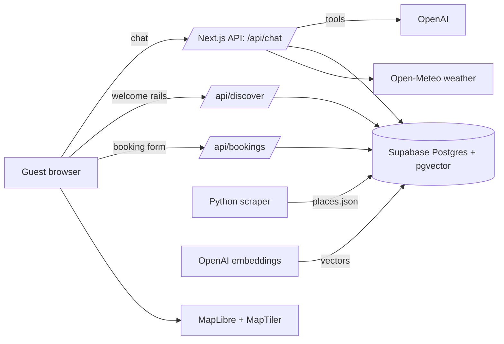
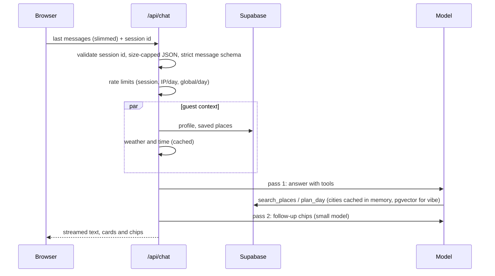

# Pearl Club AI Concierge

An AI travel concierge for hotels, grounded in real [Pearl Club](https://www.pearlclub.com) recommendations from locals. Guests chat, tap, plan a day and request bookings. Every place comes from Pearl Club's own data and links back to pearlclub.com.

**Live demo: https://pearlclub-concierge.vercel.app/**

<table>
  <tr>
    <td></td>
    <td></td>
    <td></td>
  </tr>
  <tr>
    <td></td>
    <td></td>
    <td></td>
  </tr>
</table>

## Try it

- Tap the four menu chips: **Find Hidden Gems**, **Plan My Day**, **Book an Experience**, **Hotel Services**.
- Ask in your own words: _"something cozy for a rainy afternoon"_, _"a romantic dinner with natural wine"_, _"swap the lunch stop"_, _"vegetarian and on a budget"_.
- Tap **Use my location** for distance-sorted picks and a neighbourhood-aware welcome.
- Switch language (EN, ES, FR, DE, AR, UR; Arabic and Urdu render right to left).
- Open `https://pearlclub-concierge.vercel.app/?hotel=casa-mar` for the second demo hotel (Barcelona, different branding and city).
- Ask about a city Pearl Club doesn't cover, or something off-topic, and see the guardrails.

## What it does

- **Instant welcome screen.** Live weather, local time and rails of real places ("Good for this evening", "Loved by locals nearby", "Easy on the wallet") appear with no model call.
- **Find Hidden Gems.** Semantic ("vibe") search over about 1,800 curated places, shown as cards with the photo, price, distance and the **local who recommended it**.
- **Plan My Day.** A walkable morning-to-evening route with walking times between stops, a numbered map, rain-aware indoor picks, and per-stop **Swap**.
- **Book an Experience / Hotel Services.** The assistant prepares a booking request; the guest reviews and submits it. Requests are stored and listed in **My Trip** next to saved places.
- **Personalisation.** Onboarding chips, preferences the assistant learns from chat, saved places and browser location. Preferences are also kept in the browser, so they load instantly.
- **Follow-up chips** after every answer, and visible progress ("Searching local favourites…") while it works.

## Architecture



### A chat turn



### Code layout

```
src/
  app/          routes only: thin API handlers, error and not-found pages
  server/       server-only code
    ai/         model choice, prompts, planner, tools (one file each), chat orchestration
    context/    weather, geocoding, live context, welcome rails
    db/         typed Supabase client and repositories (places, profiles, saves, bookings, usage)
    http/       request guards, rate limiting, errors, cron auth
    search/     place search ranking, embeddings, vector matching
    env.ts      validated configuration (the only place that reads process.env)
  lib/          shared: domain constants, zod schemas, i18n (one file per language), hotels, cities
  client/       browser-only: typed API client, hooks, session and local storage helpers
  components/   UI by feature: chat, cards, layout, welcome, trip, ui
supabase/       schema.sql, migrations, seed and embedding scripts
scraper/        Python scraper for Pearl Club's public listings
tests/          fixtures, helpers and dataset checks
```

## Key decisions

- **Tool calling, not free generation.** The model can only recommend places returned by `search_places` or `plan_day`, so nothing is invented. Every card links to its Pearl Club page.
- **Hybrid retrieval.** Embeddings (pgvector, `text-embedding-3-small`) handle "vibe" queries; filters handle category, price and distance; keyword search is the fallback.
- **The server plans the day.** `plan_day` picks stops and a walking route itself in one step, which is faster and more reliable than having the model search and assemble. The model only chooses the theme and mood.
- **Human-confirmed bookings.** The model proposes a form, the guest submits it, and the form posts to the API directly. The model never creates a booking.
- **Native Pearl Club look.** The UI follows pearlclub.com's design system (Karla, Space Mono and Cormorant type, black buttons, pill chips, 24px cards with the flag, category emoji and price strip, the gradient-ring search field and the mobile tab bar), so it reads as part of the same product.
- **Locals first.** Each place carries the Pearl Club local who recommended it. That is the brand's edge over generic travel AI, so it is shown on every card.
- **Multi-tenant by config.** Hotels are data (`?hotel=`), so a new hotel is configuration, not code.
- **Cost and abuse guards.** Caps per session, per IP per day and for the whole demo per day; output-token ceilings on every model call; input and body-size limits.
- **Scraping scope.** Pearl Club's city pages load listings from their own GraphQL API. The scraper replays that request politely (about 1 request per second, cached): 5 cities, 1,779 places.

## Brief → feature mapping

| Brief requirement             | Implemented as                                                                                   |
| ----------------------------- | ------------------------------------------------------------------------------------------------ |
| Conversational interface      | Streaming chat via Vercel AI SDK + OpenAI, with rich cards                                       |
| Pearl Club content            | Scraper → JSON → Supabase `places` → `search_places` / `plan_day`                                |
| Personalisation               | Profile, saved places, browser location and weather in the prompt; distance and interest ranking |
| Hotel concierge bookings      | `propose_booking` → prefilled form → `/api/bookings` → Supabase → My Trip                        |
| Multilingual                  | Six languages, replies in the chosen language, RTL layout                                        |
| Context-aware recommendations | Time of day, weather and location shape the welcome rails, search and plans                      |
| Location-based suggestions    | Geolocation, distance on cards and a neighbourhood label                                         |
| Greeting and menu flow        | Welcome screen with four menu chips                                                              |
| Follow-up interaction         | A dedicated follow-up pass produces tappable chips every turn                                    |
| Hotel services                | Per-hotel service list rendered as request cards                                                 |

## Running locally

```bash
npm install
cp .env.example .env.local        # fill in the keys (table below)
```

Database (Supabase SQL editor):

- **New database:** run `supabase/schema.sql` (everything in one file).
- **Existing database:** run `supabase/migration_002.sql`, then `supabase/migration_003.sql`.

```bash
npx tsx supabase/seed.ts          # loads scraper/output/places.json
npx tsx supabase/embed.ts         # creates the embeddings (about 1 cent, resumable)
npm run dev
```

Re-scrape (optional): `cd scraper && python -m venv .venv && . .venv/bin/activate && pip install -r requirements.txt && playwright install chromium && python scrape.py && python normalize.py`. `discover.py` is the reconnaissance script that found the GraphQL endpoint (see its docstring).

### Scripts

| Command                                       | What it does                                          |
| --------------------------------------------- | ----------------------------------------------------- |
| `npm run dev` / `build` / `start`             | Next.js dev server, production build, serve           |
| `npm run lint` / `typecheck` / `format:check` | ESLint, `tsc --noEmit`, Prettier                      |
| `npm test`                                    | Vitest unit and API-route tests (no keys, no network) |
| `npm run check`                               | Lint, typecheck, tests and the production build       |

### Environment

| Variable                                                                          | Required        | Purpose                                                                                  |
| --------------------------------------------------------------------------------- | --------------- | ---------------------------------------------------------------------------------------- |
| `NEXT_PUBLIC_SUPABASE_URL`, `SUPABASE_SERVICE_ROLE_KEY`                           | yes             | Database. The service key is server-only and never reaches the browser                   |
| `OPENAI_API_KEY`, `OPENAI_MODEL`                                                  | yes (or Gemini) | Chat model, for example `gpt-4.1-mini`. Optional `OPENAI_FAST_MODEL` for follow-up chips |
| `GOOGLE_GENERATIVE_AI_API_KEY`, `AI_MODELS`                                       | alternative     | Gemini fallback when no OpenAI key is set (vector search is then replaced by keywords)   |
| `NEXT_PUBLIC_MAPTILER_KEY`                                                        | recommended     | Map tiles. The key is public by design: restrict it to your domain in MapTiler           |
| `MAX_MESSAGES_PER_SESSION`, `MAX_MESSAGES_PER_IP_PER_DAY`, `MAX_MESSAGES_PER_DAY` | no (40/80/1500) | Chat caps per browser, per IP per day and for the whole demo per day                     |
| `MAX_WRITES_PER_IP_PER_DAY`, `MAX_LOOKUPS_PER_IP_PER_DAY`                         | no (300/60)     | Caps on writes (bookings, saves, profile) and geocoded lookups                           |
| `CRON_SECRET`                                                                     | for retention   | Protects `/api/cron/purge`; Vercel sends it as a Bearer token. 16+ random characters     |
| `ENFORCE_DAILY_LIMITS`, `LOG_LEVEL`                                               | no              | Apply daily caps outside production; `debug`, `info`, `warn` or `error`                  |

Configuration is validated once at startup (`src/server/env.ts`); a missing or malformed value fails with one message listing every problem.

## Testing

`npm test` runs about 200 tests in a few seconds with no network access or API keys:

- **Pure logic:** distance, search ranking (seeded randomness), the day planner, prompts, history trimming, Markdown rendering, error classification.
- **Security regressions:** forged session ids can never touch other counters, `system` messages and forged tool results are rejected, body-size caps hold without a `Content-Length`, ids cannot alter query filters.
- **Contracts:** all six languages have the same keys and `{placeholders}`; booking, chat and profile schemas; the scraped dataset (ids, categories, cities) and the scraper's category map agree with the app.
- **API routes** with mocked repositories and model: bookings (including idempotent replay), saves, profile, chat, discover, cron.

## Security and privacy

- **No accounts.** A random id in the browser identifies the session; all data is keyed by it.
- **Personal data stored:** booking requests (guest name, email, optional room number and notes) and, per session, preferences and saved places. Chat messages are not stored. Booking requests are deleted after 90 days and rate-limit counters after 2 to 30 days by a daily cron job.
- **Access control:** the database is only reachable with the server's service-role key. Row-level security is on with no policies, and the database functions are not callable with the public key.
- **Input handling:** every API input is validated with zod; the chat schema accepts only user and assistant messages and completed calls to the app's own tools; ids use a strict character set; JSON bodies are size-capped while being read.
- **Abuse limits:** per session, per IP per day (stored hashed) and whole-demo daily caps for chat, plus write and lookup caps. Every model call has an output-token ceiling.
- **Responses:** internal errors return a generic message and a request id; details go to structured logs. Security headers (`nosniff`, referrer, permissions, frame) are set on every response.
- **Third parties:** OpenAI (chat and embeddings), Open-Meteo (weather), OpenStreetMap Nominatim or BigDataCloud (neighbourhood name, only if the guest shares their location, rounded to about 100 m) and MapTiler (map tiles).

## Limitations

- **Bookings are requests, not live inventory.** There is no payment and no email: the guest gets an in-app confirmation, and a hotel-side console to confirm requests is not built yet. Requests are idempotent, so a retry never creates a duplicate.
- **The data is a snapshot** of Pearl Club's public listings. Neighbourhood names are not in the source data, and most London picks are credited to the same local because that is how the source data is distributed.
- **Place descriptions are shown in their original language.** The assistant's replies and the interface are translated.
- Demo hotels are fictional. Weather and neighbourhood lookups use free public services with short timeouts and graceful fallbacks.

_Not used on purpose:_ Builder.io, DatoCMS, Lemon Squeezy, Perplexity, Replicate, Llama.
